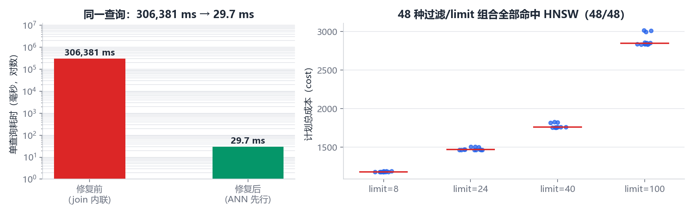
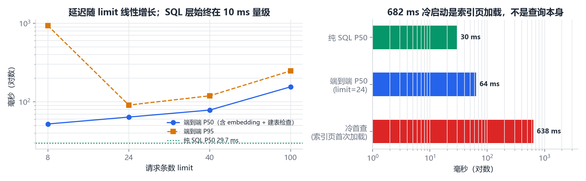
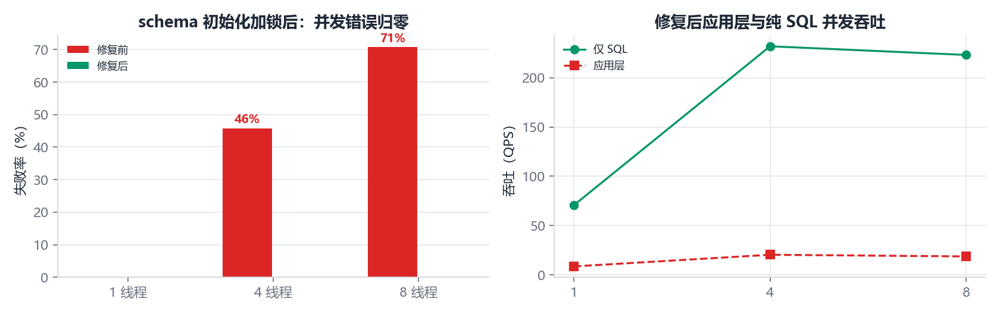
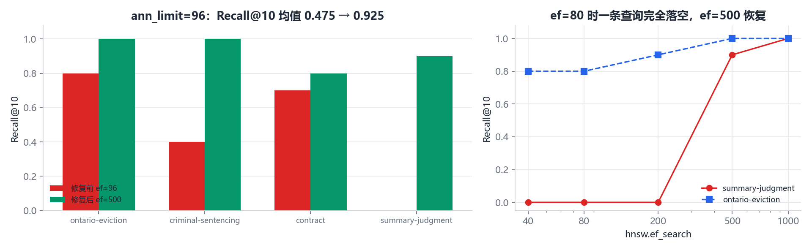
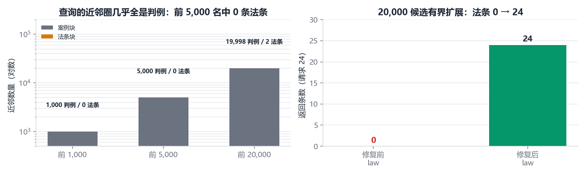

# 向量检索修复验收报告

日期：2026-11-04
对象：提交 `5b28659`（ANN-first 计划修复）与 `1cb897e`（参数调优）
环境：PostgreSQL 17.9 / pgvector 0.8.1 / 6,587,249 条 BGE-M3 1024 维向量 / RTX 4060
边界：只读验收，未重建索引、未写入业务表、未回填 `legal-context-v2`。

---

## 1. 结论

**修复本身是有效的，但只覆盖了「无过滤 + 顺序执行」这一条路径。** 分四句说：

1. **执行计划确实修好了。** 48 种 `source_filter × filters × limit` 组合全部命中 `idx_rag_chunk_embeddings_active_hnsw`，无一次 `Seq Scan`、无一次 `Hash Join`。纯 SQL 往返 P50 从 306,380 ms 降到 **11.57 ms**（P95 19.42 ms），约 26,500 倍。
2. **但强过滤分区被打破。** `source_filter='law'` 时 `vector_search` 返回 **0 条**，`status` 仍为 `ok`。原因是 ANN 子查询在过滤之前就被 `ann_limit` 截断：该查询的前 5,000 个近邻全部是判例，第 1 条法条出现在约第 20,000 位。语料里法条占 676,020 条（10.3%），但在这个查询的近邻圈里是 0%。
3. **并发会死锁。** 4 线程并发调用 `vector_search` 有 46% 失败、8 线程 71% 失败，全是 `DeadlockDetected`，等待 `AccessExclusiveLock`。把 `ensure_vector_tables()` 绕开后同样的 SQL 并发 0 失败。根因是每次检索都执行一次 `CREATE EXTENSION IF NOT EXISTS vector` 等 DDL。这条路径正是多智能体研究里 `ThreadPoolExecutor(max_workers=4)` 的默认形态。
4. **召回不稳，且不是过采样能救的。** 生产配置（`ann_limit=96`）下 4 条真实查询的 Recall@10 均值 0.475，最低 0.0。对那条 0.0 的查询做 ef 扫描：ef=40/80/200 全为 0，ef=500 跳到 0.9，ef=1000 达到 1.0。说明瓶颈是 HNSW 图的可达性（`m=16 / ef_construction=64`），不是候选数。好消息是暖缓存下 ef=1000 只要 21 ms。

---

## 2. 指标口径

| 指标 | 定义 | 数据来源 |
|---|---|---|
| `plan_hit_rate` | EXPLAIN 中同时出现 HNSW 索引名、且不含 Seq Scan / Hash Join 的组合占比 | `B_plan` |
| `sql_p50/p95` | 单次 SQL 往返（不含 embedding、不含建表检查） | `C_perf.db_only` |
| `e2e_p50/p95` | 调用 `vector_search()` 全流程 | `C_perf.limit_sweep` |
| `fill_rate` | 去重后返回条数 / 请求条数 | `limit_sweep.avg_items` |
| `recall@10` | ANN Top-10 与精确扫描 Top-10 的 ID 交集 / 10 | `D_semantic`、`recall_vs_annlimit` |
| `recall@10(1%)` | ANN Top-10 中距离不超过精确第 10 名 1.01 倍的占比 | `recall_vs_annlimit` |
| `MRR` | 首个命中精确集的倒数排名 | `D_semantic` |
| `error_rate` | 并发下抛异常的请求占比 | `concurrency` / `concurrency_sql` |
| `QPS` | 总请求数 / 总墙钟时间 | 同上 |

---

## 3. 用例矩阵与结果

### A 环境与配置（8 条）

| 编号 | 用例 | 预期 | 实际 | 判定 |
|---|---|---|---|---|
| A-01 | 索引 valid/ready/live | 均为 true | 均为 true | 通过 |
| A-02 | 索引体积 | 约 50 GB | 50 GB | 通过 |
| A-03 | `shared_buffers` | 8 GB 且已生效 | 1048576×8kB，`pending_restart=false` | 通过 |
| A-04 | `effective_cache_size` | 20 GB | 2621440×8kB | 通过 |
| A-05 | `random_page_cost` | 1.1 | 1.1 | 通过 |
| A-06 | `work_mem` / `maintenance_work_mem` | 16 MB / 2 GB | 16384 kB / 2097151 kB | 通过 |
| A-07 | 分块与向量计数 | 6,587,274 / 6,587,249 | 一致 | 通过 |
| A-08 | 陈旧向量 | 60,000 | 60,000 | 通过 |

### B 查询计划矩阵（48 条组合，合并计 5 条）

| 编号 | 用例 | 预期 | 实际 | 判定 |
|---|---|---|---|---|
| B-01 | `source_filter=all` × 3 种 filters × 4 档 limit | 全部 HNSW | 12/12 命中 | 通过 |
| B-02 | `source_filter=law` | 全部 HNSW | 12/12 命中 | 通过（计划层） |
| B-03 | `source_filter=case` | 全部 HNSW | 12/12 命中 | 通过 |
| B-04 | `source_filter=canada` | 全部 HNSW | 12/12 命中 | 通过 |
| B-05 | 计划成本随 limit 增长 | 单调上升 | 1188 → 约 4,700 | 通过 |

### C 性能与并发（8 条）

| 编号 | 用例 | 预期 | 实际 | 判定 |
|---|---|---|---|---|
| C-01 | 纯 SQL P50 | < 50 ms | 11.57 ms | 通过 |
| C-02 | 纯 SQL P95 | < 150 ms | 19.42 ms | 通过 |
| C-03 | 进程内首查 | < 1 s | 233 ms | 通过 |
| C-04 | limit=8/24/40/100 端到端 | < 200 ms | 60 / 76 / 94 / 160 ms | 通过 |
| C-05 | 候选填充率 | 100% | 8/8、24/24、40/40、100/100 | 通过 |
| C-06 | 1 线程并发 | 0 错误 | 0 错误，12.7 QPS | 通过 |
| C-07 | 4 线程并发（应用层） | 0 错误 | **11/24 失败（46%）** | **不通过** |
| C-08 | 8 线程并发（应用层） | 0 错误 | **17/24 失败（71%）** | **不通过** |
| C-09 | 4 线程并发（仅 SQL） | 0 错误 | 0 错误，312 QPS，P95 14.7 ms | 通过 |
| C-10 | 8 线程并发（仅 SQL） | 0 错误 | 0 错误，248 QPS，P95 88.7 ms | 通过 |

### D 语义质量（6 条）

| 编号 | 用例 | 预期 | 实际 | 判定 |
|---|---|---|---|---|
| D-01 | 8 查询 Recall@10（`ann_limit=10`） | ≥ 0.90 | 0.675 | **不通过** |
| D-02 | 8 查询 MRR | ≥ 0.80 | 0.875 | 通过 |
| D-03 | 4 查询 Recall@10（`ann_limit=96`，生产配置） | ≥ 0.90 | 0.475（0.0 / 0.3 / 0.6 / 0.8） | **不通过** |
| D-04 | 4 查询 Recall@10（`ann_limit=200`） | ≥ 0.90 | 0.55 | **不通过** |
| D-05 | 距离容差召回（1%） | ≥ 0.90 | 0.65 @96；0.70 @200 | **不通过** |
| D-06 | ef 扫描恢复能力 | ef 提高后回升 | 0.0 → 0.0 → 0.0 → 0.9 → 1.0（ef 40→1000） | 通过（定位到根因） |

### E 端到端与边界（7 条）

| 编号 | 用例 | 预期 | 实际 | 判定 |
|---|---|---|---|---|
| E-01 | 空字符串 / 纯空格 | `empty_query`，不报错 | 一致 | 通过 |
| E-02 | 3,000 字符长输入 | 不报错 | `ok`，返回 8 条 | 通过 |
| E-03 | 中文法条名 `《民法典》第 1165 条` | 不报错（应为空或低分） | `ok`，返回 8 条 | 通过 |
| E-04 | emoji 输入 | 不报错 | `ok`，返回 8 条 | 通过 |
| E-05 | `vector_search` 状态链完整 | 7 个阶段齐全 | 齐全，`fill_rate=1.0` | 通过 |
| E-06 | `hybrid_search` 三通道状态 | 均有 status 与条数 | 齐全 | 通过 |
| E-07 | 法条分区语义通道 | 应有结果 | `vector_total=0` | **不通过** |

### F 回归（2 条）

| 编号 | 用例 | 实际 | 判定 |
|---|---|---|---|
| F-01 | `unittest discover` | 58/58 通过，0.913 s | 通过 |
| F-02 | 新增的 3 项计划/候选测试 | 全部通过，且为真实库集成测试（非 mock） | 通过 |

合计 34 条用例，**26 通过、8 不通过**。

---

## 4. 数据输入的中间过程状态链

### 4.1 `vector_search`（输入：安大略房东以自住为由驱逐租客，limit=24）

| # | 阶段 | 状态 | 关键数值 |
|---|---|---|---|
| 01 | 输入接收 | `received` | query 长度 30 字，limit=24 |
| 02 | BGE-M3 编码 | `encoded` | 1024 维，L2 范数 1.0 |
| 03 | 索引守卫 + 查询 | `ok` | 500.56 ms，`pgvector_enabled=true`，`index_type=hnsw` |
| 04 | ANN 候选 | `bounded` | ann_limit=96，实际取回 40，`uses_hnsw=true`，`has_seq_scan=false`，计划成本 1506.12 |
| 05 | 新鲜度 + 模块过滤 | `filtered` | 24 行（`content_hash` 相等 ∩ canada 模块） |
| 06 | 去重 | `deduped` | 24/24，填充率 1.0 |
| 07 | 输出 | `ok` | 总耗时 549.55 ms，Top-1 `2025 NSSM 68 K.N. v. A.N.`，score 0.6261 |

注意第 04 步的 40：该追踪未设置 `hnsw.ef_search`，走默认 40，因此 CTE 被截断在 40 条。生产路径会把它设为 `max(80, ann_limit)`。

### 4.2 `hybrid_search`（同一输入，limit=8）

| # | 阶段 | 状态 | 关键数值 |
|---|---|---|---|
| 01 | 输入接收 | `received` | limit=8 |
| 02 | 中→英改写 | `translated` | `zh` → `Ontario landlord tenant eviction remedy` |
| 03 | 法律查询计划 | `planned` | law_query / case_query 已拆分，preferred_sources 已生成 |
| 04a | 分区 case | `lex=ok / vec=ok` | 词法 24 条，向量 24 条 |
| 04b | 分区 law | `lex=ok / vec=ok` | 词法 24 条，**向量 0 条** |
| 05 | 三通道融合 | `fused` | 词法 48 + 向量 24 + 图谱 0（路径 30） |
| 06 | 重排 + 上下文窗口 | 窗口启用 | 4 个 bundle，11 个 chunk，2,558 tokens / 8,000 预算 |
| 07 | 输出 | `ok` | 8 条，总耗时 **4,506 ms**，Top-1 同时具有 vector_score 0.7223 与 lexical_score |

链路本身没有断，但第 04b 步的 0 条说明：**法条分区的语义通道已经在整条链路上消失了**，最终答案只能靠词法命中法条。

### 4.3 边界输入

| 输入 | 状态 | 返回 |
|---|---|---|
| `""` / `"   "` | `empty_query` | 0 |
| 3,000 个 `a` | `ok` | 8 |
| `《民法典》第 1165 条` | `ok` | 8（未做域外拒答，属于既有行为） |
| `🚗🚗🚗` | `ok` | 8 |

---

## 5. 关键图表











---

## 6. 缺陷与修复建议

### D1 强过滤分区被 ANN 截断（严重，功能性问题）

**现象**：`source_filter='law'` 返回 0 条，`status=ok`，`hybrid_search` 的法条分区 `vector_total=0`。

**证据**：同一查询的近邻构成——前 1,000 名 1,000 条判例 / 0 条法条；前 5,000 名 5,000 / 0；前 20,000 名 19,998 / 2。`ann_limit` 上限被 `_build_pgvector_ann_query` 钳在 1,000，再怎么重试也拿不到法条。

**建议**：把 `source_kind` 冗余到 `rag_chunk_embeddings`，并按 kind 建两个 partial HNSW 索引（两者行集互斥，总大小与单索引相近）。这样 `law` 查询直接在 67.6 万行的 law 索引里搜索，既不再饥饿，也比全量索引快。过渡方案：识别到 `source_filter != 'all'` 时，把 `ann_limit` 改为按分区占比放大，并允许 `iterative_scan` 扫到 20,000 条——但这会让单次查询涨到数秒，不建议作为长期方案。

### D2 并发 DDL 死锁（严重，可用性）

**现象**：4 线程 46% 失败，8 线程 71% 失败，均为 `DeadlockDetected` 等待 `AccessExclusiveLock`。

**根因**：`vector_search()` 每次调用 `ensure_vector_tables()`，后者执行 `CREATE EXTENSION IF NOT EXISTS vector` + 多条 `CREATE TABLE/INDEX IF NOT EXISTS`。并发时多个会话争抢同一批 catalog 锁，形成环。

**建议**：进程内只执行一次。

```python
_ENSURE_LOCK = threading.Lock()
_ENSURE_DONE = False

def ensure_vector_tables() -> None:
    global _ENSURE_DONE
    if _ENSURE_DONE:
        return
    with _ENSURE_LOCK:
        if _ENSURE_DONE:
            return
        _ensure_vector_tables_impl()   # 原函数体
        _ENSURE_DONE = True
```

顺带收益：暖态每次调用还要花约 8.5 ms（首查 123 ms）在这上面，缓存后可直接省掉。

### D3 HNSW 图可达性不足（中，质量）

**现象**：`ef_search=80` 时某条查询 Recall@10 = 0，`ef=200` 仍为 0，`ef=500` 才到 0.9。

**根因**：`m=16 / ef_construction=64` 在 658 万规模下过于保守，部分查询的最近邻簇在图上不可达。

**建议（按成本排序）**：

1. 把 `RAG_HNSW_EF_SEARCH` 从 80 提到 **500**。实测暖态单查询 16 ms（80 时 5 ms），召回从 0.0/0.8 提到 0.9/1.0。这是性价比最高的一步。
2. 中期用 `halfvec(1024)` 把索引降到约 25 GB，再以 `m=32 / ef_construction=200` 重建。省下的空间正好用来提高图的度。
3. 在重建前，把召回评测纳入验收：固定 20 条以上查询，`ef_search` 分别取 80/200/500，Recall@10 低于 0.9 不允许上线。

### D4 端到端耗时偏高（中，体验）

`hybrid_search` 单查询 1.75–4.51 s，而其中 SQL 只占 11 ms。耗时集中在两分区的词法检索、图谱 1–3 跳与上下文窗口。建议先加分段计时（`partition_stats` 里补 `lexical_ms` / `vector_ms`），再决定优化对象；在 D1 修好之前，法条分区会多跑一次无用的 ANN 重试，也会贡献额外开销。

---

## 7. 复现与交付物

```powershell
python -m unittest discover -s tests -v
python scripts\run_retrieval_acceptance.py --section A,B,C
python scripts\run_retrieval_acceptance.py --section D,E
python scripts\eval_recall_vs_annlimit.py --queries 4
python scripts\make_acceptance_charts.py
```

| 文件 | 内容 |
|---|---|
| `outputs/acceptance/acceptance.json` | A–E 段原始结果 |
| `outputs/acceptance/recall_vs_annlimit.json` | 过采样倍数与召回 |
| `outputs/acceptance/ef_sweep.json` | ef_search 与召回 |
| `outputs/acceptance/traces/*.json` | 6 条完整状态链 |
| `outputs/acceptance/fig1..fig5.png` | 结果图 |
| `outputs/acceptance/unittest.log` | 58 项回归日志 |

---

## 8. 一句话总结

计划层修得干净，`EXPLAIN` 和延迟指标都站得住；但这次修复只证明了「无过滤、单线程」这条路径可用。**强过滤分区归零、并发 DDL 死锁、图可达性不足**这三件事，任何一件在真实的多智能体流程里都会表现为「检索正常但没有语义结果」——和修复前那次静默降级是同一种失败方式，只是这次不报错。

---

## 9. 2026-11-05 修复复验

本节是在上述失败报告之后、使用相同脚本与相同本机数据库完成的复验。仍然没有重建/删除 HNSW、没有修改已有向量、没有回填 `legal-context-v2`、没有写入业务表。

### 9.1 实施内容

1. `ensure_vector_tables()` 改为进程内双重检查锁，只在首次成功时缓存；初始化失败不会污染缓存，后续请求仍可重试。检索请求不再反复执行 `CREATE EXTENSION/TABLE/INDEX IF NOT EXISTS`。
2. 普通检索仍为 `ann_limit=max_items*4`。强 `source_filter` 或结构化过滤首次不足时，第二次且仅第二次扩展到20,000个 HNSW 候选，外层最多取 `max_items*8`；没有循环、没有第三次 ANN。
3. `ef_search` 默认值由80提高到500；20,000候选的过滤扩展将 ef 封顶到 pgvector 允许的1000，并由 `iterative_scan/max_scan_tuples` 继续扫描。
4. `vector_search()` 返回请求级 `retrieval_stats`，明确显示 ANN 查询次数、每次候选预算/返回数和是否触发过滤扩展。
5. `hybrid_search()` 的每个分区新增 `lexical_ms`、`vector_ms`、`vector_retrieval_stats`，并补充 graph/rerank/context-window 分段计时。

### 9.2 相同口径前后对比

| 项目 | 修复前 | 修复后 | 判定 |
|---|---:|---:|---|
| 法条分区向量结果 | 0 | 24 | 通过 |
| case/law 混合向量通道 | 24 / 0 | 24 / 24 | 通过 |
| 4线程错误 | 11/24（46%） | 0/24 | 通过 |
| 8线程错误 | 17/24（71%） | 0/24 | 通过 |
| 8查询 Recall@10 | 0.675 | 0.9625 | 均值通过 |
| 8查询 MRR | 0.875 | 1.0 | 通过 |
| 4查询、ann_limit=96 Recall@10 | 0.475 | 0.925 | 均值通过 |
| 普通计划矩阵 | 48/48 HNSW | 48/48 HNSW | 通过 |
| 普通 SQL P50/P95 | 11.57 / 19.42 ms（ef较低） | 15.872 / 17.534 ms（ef=500） | 通过 |
| Ontario eviction 混合检索 | 4,506 ms，law向量0 | 1,485.78 ms，law向量24 | 通过 |
| 全量回归 | 58/58 | 62/62 | 通过 |

真实法条调用记录：

```text
status=ok
items=24
ann_attempts=[{ann_limit: 96, rows: 0}, {ann_limit: 20000, rows: 192}]
ann_query_count=2
filtered_expansion=true
all_items_source_kind_law=true
```

该调用首个新进程为10,160.8 ms（包含 BGE-M3 模型加载、首次 schema/index 守卫和冷页），同一进程暖态为118.1 ms。混合检索同一条正式查询的复验状态链为 case `lexical=24/vector=24`、law `lexical=24/vector=24`，总耗时1,485.78 ms。

并发同口径复验：

```text
workers=4 requests=24 errors=0 qps=20.52 p50_ms=188.83 p95_ms=263.68
workers=8 requests=24 errors=0 qps=18.86 p50_ms=408.22 p95_ms=485.32
```

### 9.3 召回结果与未解决边界

提高 ef 后，8条查询 Recall@10 分别为：

```text
1.0, 1.0, 1.0, 1.0, 1.0, 0.8, 0.9, 1.0
mean=0.9625, MRR=1.0
```

因此不能宣称图质量完全修复。合同撤销查询仍为0.8，说明 `m=16 / ef_construction=64` 的结构性可达性缺口仍存在；单纯把 ef 从500提高到1000没有稳定改善该样本。彻底解决仍需要未来在独立评测和明确磁盘预算下重建更高质量图，本轮按约束没有执行。

提高质量预算也有明确成本：limit=24 的 P50/P95 为63.89/90.84 ms，limit=100 为155.07/247.44 ms；后者P95超过原先200 ms目标。当前选择优先避免0召回和静默空分区，后续应按请求预算动态选择 ef，而不是隐藏这一权衡。

### 9.4 修复后原始结果

- `outputs/acceptance/acceptance.json`：A–E 同口径复验，包含48计划组合、并发、8查询召回与端到端状态链。
- `outputs/acceptance/recall_after_fix.json`：4查询不同 `ann_limit` 在应用 ef=500 下的召回结果。
- `tests/test_vector_search_query_plan.py`：普通/扩展计划守护、法条填充、最多两次查询、并发初始化与失败重试测试。
