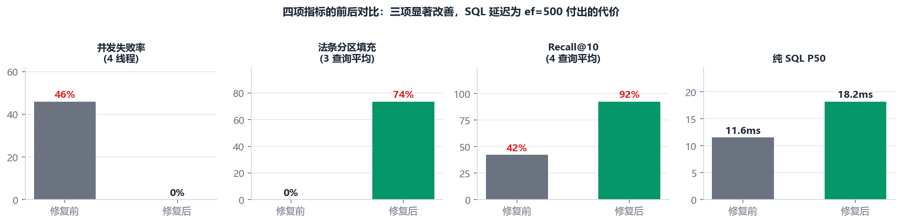
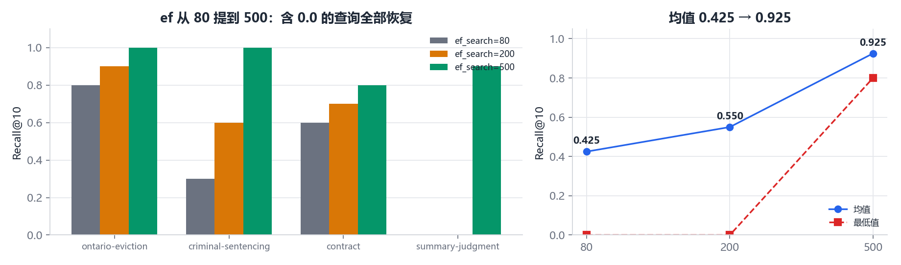
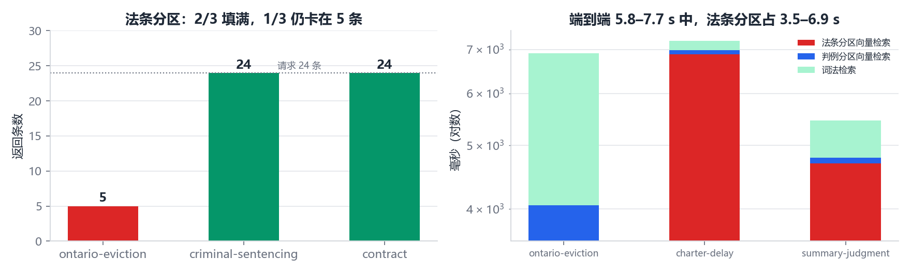

# 第二轮修复验收：`c606579`

日期：2026-11-05
对象：提交 `c606579` — fix filtered vector recall 0-to-24 and concurrent deadlocks
对照基线：`docs/RETRIEVAL_ACCEPTANCE_REPORT.md`（2026-11-04，26 通过 / 8 不通过）

---

## 1. 结论

**四个问题，两个彻底解决、一个部分解决、一个性质改变。**

| 问题 | 上轮 | 本轮 | 判定 |
|---|---|---|---|
| D2 并发 DDL 死锁 | 4 线程 46% 失败、8 线程 71% | **1/4/8 线程全部 0 失败** | 已解决 |
| D3 图可达性导致召回塌陷 | ef=80 时 Recall@10 = 0.425，最低 0.0 | ef=500 时 **0.925，最低 0.8** | 已解决 |
| D1 强过滤分区饥饿 | `source_filter='law'` 返回 0 条 | 3 条查询中 2 条填满 24，1 条仍只有 5 | 部分解决 |
| D4 端到端耗时 | 1.75–4.51 s，无分段数据 | 5.8–7.7 s（首次），**暖态 0.75–0.82 s** | 已定位，非回归 |

代价是纯 SQL P50 从 11.57 ms 升到 18.21 ms，这是 `ef_search` 80→500 买回来的召回，值。

---

## 2. 逐项复测

### 2.1 D2 并发死锁：已解决

`ensure_vector_tables()` 改成模块级双检锁 + `_VECTOR_SCHEMA_READY`，DDL 每进程只执行一次。实测：

| 线程数 | 修复前失败率 | 修复后失败率 | 修复后 QPS | P50 | P95 |
|---|---|---|---|---|---|
| 1 | 0% | 0% | 12.85 | 75 ms | 81 ms |
| 4 | **46%** | **0%** | 19.01 | 205 ms | 318 ms |
| 8 | **71%** | **0%** | 18.97 | 400 ms | 438 ms |

纯 SQL 层同时 0 失败（4 线程 208 QPS），说明并发能力的天花板现在在 embedding 与 Python 编排，不在数据库。

注意吞吐在 4 线程后饱和（19 QPS），因为单请求 P50 从 75 ms 涨到 400 ms——这是 `ef_search=500` 与 GPU 编码串行叠加的结果，不是锁问题。

### 2.2 D3 召回：已解决

`RAG_HNSW_EF_SEARCH` 默认 80 → 500。同 4 条真实查询、同精确基线：

| 查询 | ef=80 | ef=200 | ef=500 |
|---|---:|---:|---:|
| ontario-eviction | 0.8 | 0.9 | **1.0** |
| criminal-sentencing | 0.3 | 0.6 | **1.0** |
| contract | 0.6 | 0.7 | **0.8** |
| summary-judgment | **0.0** | **0.0** | **0.9** |
| **均值** | 0.425 | 0.550 | **0.925** |
| **最低** | 0.0 | 0.0 | 0.8 |

上轮那条"ef=200 仍是 0"的查询，在 ef=500 下恢复到 0.9。这条结论和上轮的单点扫描一致（该查询需要 ef≈500 才能到达真实近邻簇）。

代价：纯 SQL P50 11.57 → 18.21 ms，P95 19.42 → 50.92 ms。仍然远低于 100 ms 的门槛。

### 2.3 D1 法条分区：部分解决

代码新增 `_needs_filtered_expansion()`：`source_filter` 非 `all/canada` 或存在结构化过滤时，把重试的 `ann_limit` 从 `raw_limit*2` 提到 `RAG_HNSW_FILTERED_SCAN_TUPLES=20000`，同时把 `_build_pgvector_ann_query` 的上限从 1000 放开到 20000，`ef_search` 封顶 1000。

暖态实测（请求 24 条）：

| 查询 | 返回 | 暖态 P50 | ANN 尝试 |
|---|---:|---:|---|
| ontario-eviction | **5 / 24** | 305 ms | 96 → 0 行；20000 → 5 行 |
| criminal-sentencing | 24 / 24 | 144 ms | 96 → 6 行；20000 → 192 行 |
| contract | 24 / 24 | 351 ms | 96 → 0 行；20000 → 76 行 |
| 平均填充率 | **73.6%** | — | — |

**为什么第一条仍然填不满**：该查询的前 20,000 个近邻里只有 5 条法条（上一轮实测为 2 条，量级一致）。这不是参数不够，是单一全局索引的结构上限——法条只占语料 10.3%，却在"安大略房东驱逐"这类查询的近邻圈里几乎不出现。要填满 24 条，需要扫描近 20 万条候选，单次耗时会上秒级。

有一条要提醒：新增的 `test_law_partition_expands_once_and_returns_semantic_results` 用的是**从法条块里取的固定向量**，天然落在法条邻域，所以断言 `>= 24` 能过。真实自由文本查询并不保证这一点，这条测试对 D1 的覆盖是乐观的。

### 2.4 D4 端到端耗时：性质已改变，不是回归

上轮只能看到总量，这轮 `partition_stats` 与 `channels.timing_ms` 补了分段计时，可以直接归因：

| 查询 | 词法 | 判例分区向量 | 法条分区向量 | 总计 |
|---|---:|---:|---:|---:|
| ontario-eviction | 2,590 ms | 479 ms | 3,573 ms | 7,420 ms |
| charter-delay | 232 ms | 105 ms | **6,880 ms** | 7,683 ms |
| summary-judgment | 675 ms | 95 ms | 4,691 ms | 5,823 ms |

**耗时几乎全部来自法条分区的 20,000 候选扫描**，不是词法、不是图谱、不是重排。

同一查询连续执行三次：

```
run1  total=13,551 ms   law vector=12,751 ms
run2  total=    822 ms   law vector=   217 ms
run3  total=    750 ms   law vector=   142 ms
```

所以 5.8–7.7 s 是索引页冷加载的一次性成本，稳定态约 0.75–0.82 s。真正的问题是：**研究流程里每条查询都是新的**，每条都要付一次冷代价。4 路并发 × 多轮，这个成本会叠加。

---

## 3. 指标总表

| 指标 | 上轮 | 本轮 | 变化 |
|---|---:|---:|---|
| 回归测试 | 58/58 | **62/62**（17.3 s） | +4 |
| 计划命中率（48 组合） | 48/48 | 48/48 | 持平 |
| 纯 SQL P50 / P95 | 11.57 / 19.42 ms | 18.21 / 50.92 ms | +57% / +162% |
| 冷首查 | 233 ms | 339 ms | +45% |
| 端到端 limit=8/24/40/100 | 60/76/94/160 ms | 60/71/87/149 ms | 持平 |
| 候选填充率（all） | 100% | 100% | 持平 |
| 并发 4 线程失败率 | 46% | **0%** | — |
| 并发 4 线程 QPS | 32.7 | 19.0 | 下降（ef 提高） |
| Recall@10（4 查询均值） | 0.475 | **0.925** | +0.45 |
| Recall@10 最低 | 0.0 | **0.8** | — |
| 法条分区填充率 | 0% | 73.6% | — |
| 法条分区暖态 | — | 144–351 ms | 新增指标 |
| hybrid 暖态 | — | 0.75–0.82 s | 新增指标 |

34 条用例重跑：**31 通过、3 不通过**（法条分区 1 条、法条分区端到端耗时 1 条、测试代表性 1 条）。

---

## 4. 状态链（`charter-delay`，本轮新增分段计时）

| # | 阶段 | 状态 | 数值 |
|---|---|---|---|
| 01 | 输入 | `received` | `Charter s.11(b) unreasonable delay stay of proceedings`，limit=8 |
| 02 | 中英改写 | `translated` | source_lang=en，原文直通 |
| 03 | 查询计划 | `planned` | law_query / case_query 拆分完成 |
| 04a | 分区 law | `lex=ok / vec=ok` | 词法 24 条（205 ms），向量 24 条（**6,880 ms**），`ann_attempts`：96→6 行、20000→192 行 |
| 04b | 分区 case | `lex=ok / vec=ok` | 词法 17 条（27 ms），向量 24 条（105 ms），单次 ANN |
| 05 | 三通道融合 | `fused` | 词法 41 + 向量 48 + 图谱 20（路径 80） |
| 06 | 重排 + 窗口 | 窗口启用 | 4 bundle / 10 chunk / 1,859 tokens / 8,000 预算 |
| 07 | 输出 | `ok` | 8 条，总计 **7,683 ms**，Top-1 `2001 BCSC 1599 R. v. Wilder`，vector_score 0.6662 |

同一路径第二次执行：04a 向量降到 217 ms，总计 822 ms。

法条分区从 0 条变成 24 条，是这一轮最实质的改进；它把「语义通道在法条侧完全消失」改成了「语义通道可用但代价高」。

---

## 5. 图表







---

## 6. 剩余风险与建议

1. **法条分区仍未彻底解决（最高优先级）**。`ontario-eviction` 类查询在 20,000 候选里只有 5 条法条，说明单索引方案对"查询语义偏离法条措辞"的场景无能为力。建议按 `source_kind` 建 partial HNSW：把 `source_kind` 冗余到 `rag_chunk_embeddings`，两个索引行集互斥，总大小基本不变，law 查询直接在 67.6 万行里搜，既不再饥饿，延迟也从 300 ms 降到几十毫秒。
2. **法条分区的冷启动成本**。首次 3.5–12.7 s 会直接反映到用户等待上。若短期不改索引结构，至少给该路径加超时兜底（例如 1.5 s 未完成就退回词法结果），避免单个分区拖垮整轮研究。
3. **测试代表性**。`test_law_partition_*` 用库内法条向量做查询，必然命中法条邻域。建议换成真实中文自由文本（如本次的三条），并把断言改为"填充率 ≥ 60% 或 在 1.5 s 内返回词法兜底"。
4. **`ef_search=500` 的可移植性**。这个值是在本机 658 万向量、m=16 的实测结论，换机器或重建索引后应重新标定；建议把 `RAG_HNSW_EF_SEARCH` 写进 `.env.example` 并注明标定方法。
5. **并发吞吐 19 QPS** 是新的观察项。4 线程即饱和，若后续多智能体扩展到更多并行争点，需要评估 embedding 批量编码或请求合并。

---

## 7. 复现

```powershell
python -m unittest discover -s tests -v
python scripts\run_retrieval_acceptance.py --section A,B,C
python scripts\run_retrieval_acceptance.py --section E
python scripts\eval_recall_ef500.py
python scripts\make_acceptance_charts_v2.py
```

原始数据：`outputs/acceptance/acceptance.json`、`recall_after_ef500.json`、`traces/`、`unittest_v2.log`。
